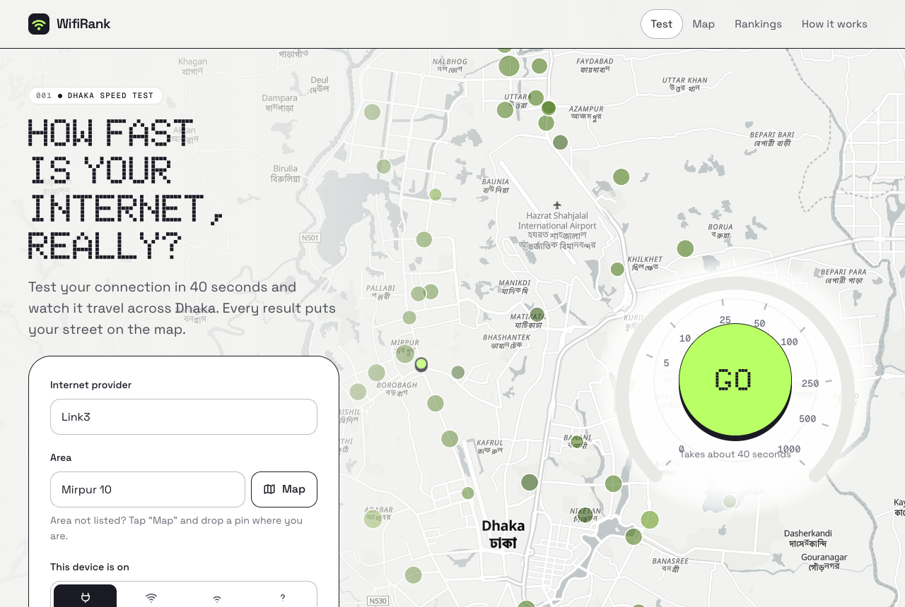
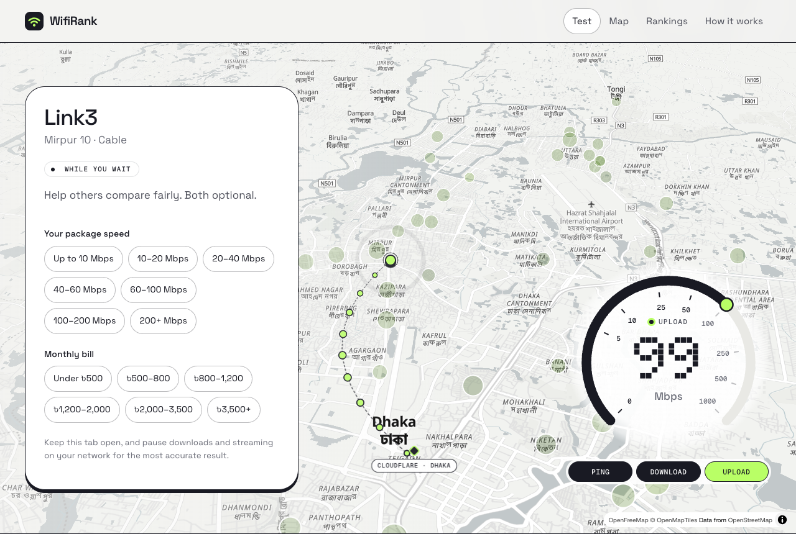
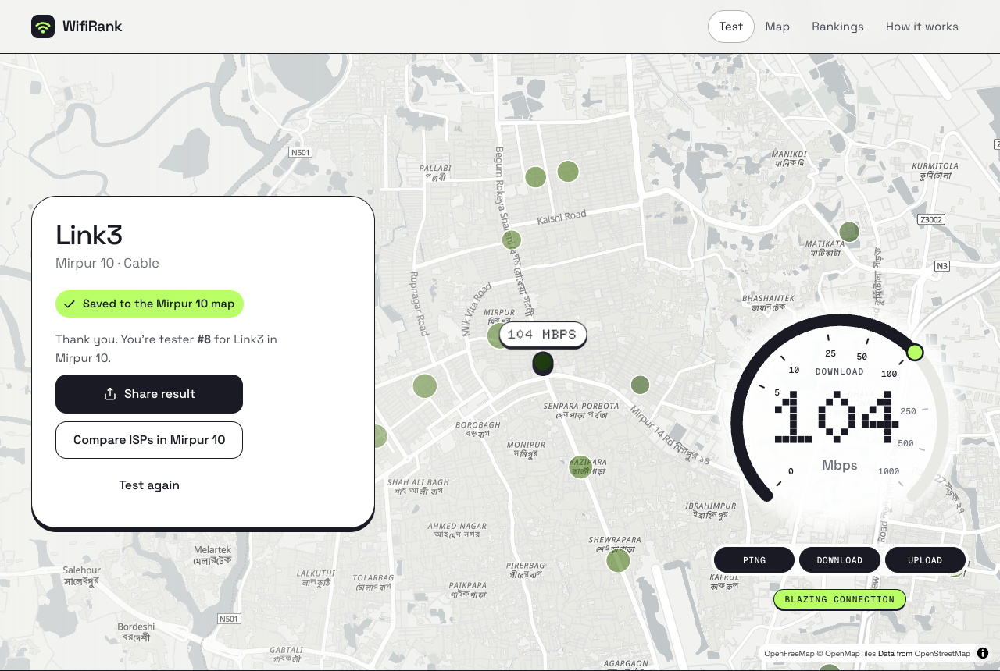
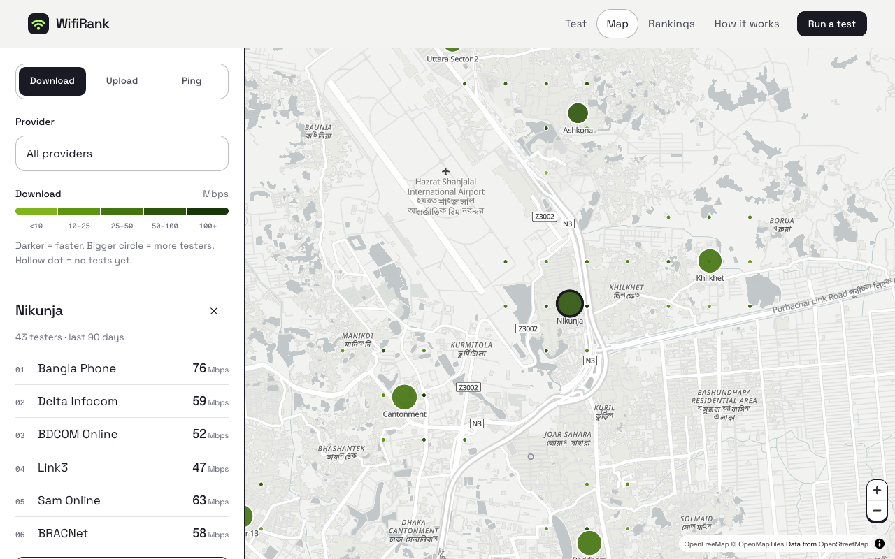
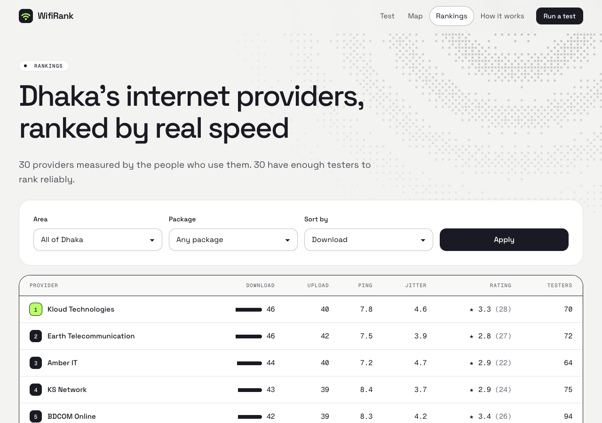
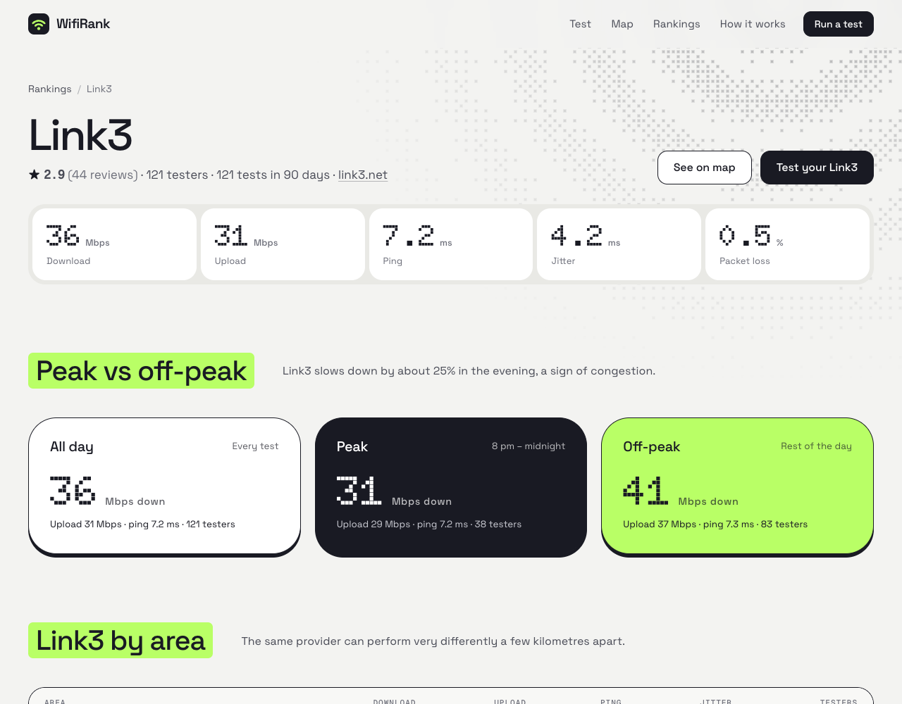
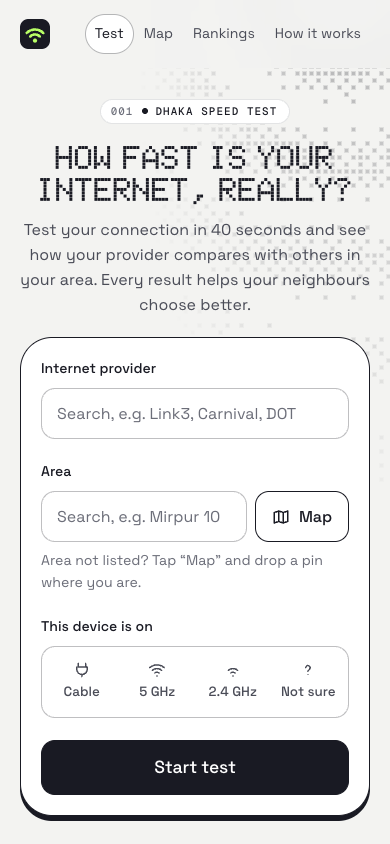

# WifiRank

Crowdsourced internet speed tests and reviews for ISPs in Dhaka. Anonymous users pick their provider and area, run a browser test, and optionally leave a review. Results are aggregated per provider and per neighbourhood.

Astro (server-rendered) + React islands + Postgres (Neon) + MapLibre.

## Screenshots

Figures in these screenshots come from local demo data, except the test result, which is a real run.

The speed test runs on a live map of Dhaka: pick your area and the map flies to it, packets stream between you and Cloudflare's Dhaka edge while it measures, and your result lands as a pin.



| Test in progress | Result |
|---|---|
|  |  |

| Map | Rankings |
|---|---|
|  |  |

| Provider page | Mobile |
|---|---|
|  |  |

## Run locally

```sh
npm install
cp .env.example .env
npm run db:local          # throwaway local Postgres (PGlite) on :5432, keep running
npm run db:migrate        # schema + 147 seeded ISPs
node --env-file=.env scripts/seed-demo.ts   # optional: fake results to design against (local DBs only)
npm run dev
```

`npm run check` runs the stats self-check. `npx astro check` type-checks.

## Deploy

1. **Database:** create a Neon project, put its *pooled* connection string in `DATABASE_URL`, then run `npm run db:migrate` once (safe to re-run; it also re-syncs `data/isps.json`).
2. **App:** deploy to Vercel. Set `DATABASE_URL`, `IP_SALT` (any long random string) and optionally `SITE_URL` (your domain, used for canonical URLs and the sitemap).
3. **Packet loss (optional):** create a Cloudflare Realtime TURN key and set `CF_TURN_KEY_ID` / `CF_TURN_API_TOKEN`.
4. **ISP check (optional):** set `IPINFO_TOKEN` for higher lookup limits.

## How the numbers work

- Tests run against Cloudflare's Dhaka edge with `@cloudflare/speedtest`. That is the domestic path; international speed is not measured (columns are prefixed `local_` to keep that explicit).
- Speeds are **sustained**: the median of requests that take 250 ms or longer, not the engine's default 90th percentile, which short bursts inflate (`src/lib/sustained.ts`).
- Each device counts once per provider (per-device median, then median across devices), last 90 days only, minimum 5 testers to rank.
- Tests over mobile data or a non-Bangladeshi IP are stored but excluded. Reviews require a completed test.
- Full explanation at `/methodology`.

## Moderation (SQL for now)

```sql
update isps set approved = true where slug = '...';    -- approve a user-added ISP
update reviews set hidden = true where device_id = '...' and isp_id = ...;
```

## Layout

| Path | What |
|---|---|
| `src/pages/` | Pages, JSON API (`api/`), `sitemap.xml`, `robots.txt`, `llms.txt`, OG images (`og/`) |
| `src/components/` | `SpeedTest` (test flow), `DhakaMap` (explorer), `LocationPicker`, `Gauge`, `Combobox` |
| `src/lib/stats.ts` | All aggregation SQL |
| `data/` | Seed ISPs and area coordinates |

### National ISP directory

Run `npm run data:build` to rebuild `data/isps.json`, `data/isp-packages.json` and `data/districts.json` from the committed `data/sources/` research snapshots. Update `curated-isps.json` and `curated-packages.json` for manual corrections; curated records and prices take precedence. Run `node scripts/check-directory.ts` to validate preservation, identifiers, districts and package provenance.

Run `npm run db:migrate` against the target database after updating the directory, so all providers become selectable in speed tests. The migration preserves ISP IDs and historical tests. Directory profiles work from the committed data even before reseeding.

District associations combine licence locations, resolved BTRC CSV districts, addresses and published coverage. Unresolved locations stay unknown. Nationwide is licence scope, not a promise of service at any address. Historical renewal dates are marked possibly lapsed only when the sole source is the December 2024 BTRC list; status is evaluated at the fixed research date in the build script. Entries marked `not-isp` by site research are excluded unless already curated. Scraper notes remain on profiles, and bdix.app packages retain their attribution. No live network access is needed to rebuild.
